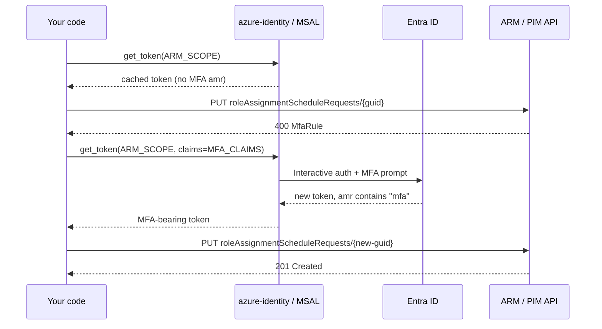

# Activating `Contributor – DEV-AssDomSC-Defaut` (PIM + MFA Claims Challenge)

> Audience: developers who need to **self-activate** the PIM-eligible role
> `Contributor` on the management group `DEV-AssDomSC-Defaut` from their
> own code / scripts (CI runners, local CLIs, automation tooling, etc.).
>
> The role is **eligible only** in Microsoft Entra PIM. You cannot use it
> until you call the activation API. The PIM policy on this role
> **requires Multi-Factor Authentication**, which means your access token
> must carry an `amr=mfa` claim. This document explains exactly how to
> obtain such a token and submit the activation request.

---

## 1. What you are calling

PIM activation is a single ARM REST call:

```
PUT https://management.azure.com/{scope}/providers/Microsoft.Authorization
    /roleAssignmentScheduleRequests/{guid}?api-version=2020-10-01
Authorization: Bearer <ARM access token with amr=mfa>
Content-Type: application/json
```

For this specific role, the values are:

| Field              | Value                                                                                              |
|--------------------|----------------------------------------------------------------------------------------------------|
| `scope`            | `/providers/Microsoft.Management/managementGroups/DEV-AssDomSC-Defaut`                             |
| `roleDefinitionId` | `/subscriptions/<any-sub-in-tenant>/providers/Microsoft.Authorization/roleDefinitions/b24988ac-6180-42a0-ab88-20f7382dd24c` (built-in **Contributor**) |
| `principalId`      | The `oid` claim of your signed-in user (your Entra object id)                                      |
| `{guid}`           | A fresh `uuid4()` you generate per request (it’s the activation request id, also the idempotency key) |
| API version        | `2020-10-01`                                                                                       |

Request body:

```json
{
  "properties": {
    "principalId": "<your-oid>",
    "roleDefinitionId": "/subscriptions/<sub-id>/providers/Microsoft.Authorization/roleDefinitions/b24988ac-6180-42a0-ab88-20f7382dd24c",
    "requestType": "SelfActivate",
    "scheduleInfo": {
      "startDateTime": "2026-06-26T13:00:00.000Z",
      "expiration": {
        "type": "AfterDuration",
        "duration": "PT8H"
      }
    },
    "justification": "Routine operational access"
  }
}
```

The maximum `duration` PIM accepts (`PT8H`, `PT4H`, …) is governed by the
role policy — if you ask for more than the policy allows, the request is
rejected.

---

## 2. The MFA problem you will hit

If you submit the PUT with a “normal” ARM token (one obtained via a
silent / cached login, or by SSO from a session that did not perform
MFA), PIM responds with **HTTP 400**:

```text
RoleAssignmentScheduleRequest request validation failed.
The following policy rules failed:
  MfaRule - Multi-factor authentication is required for this request.
```

### Why

PIM inspects the `amr` (Authentication Methods References) claim of your
access token. The policy on `Contributor – DEV-AssDomSC-Defaut`
requires `amr` to contain `"mfa"`. Most cached / SSO-issued ARM tokens
**do not** contain `"mfa"` because the original sign-in was
password-only (or device-bound SSO), so PIM refuses the activation.

Refreshing the token silently will keep returning the same non-MFA
token — there is no automatic re-prompt. You have to **explicitly ask**
the identity library to perform an interactive sign-in that satisfies
MFA. The mechanism for that is a **Claims Challenge**.

---

## 3. The fix — Claims Challenge

A claims challenge is a small JSON document you pass to MSAL /
`azure-identity` telling it: *“the access token you give me must
contain these claims; if the cached one doesn’t, throw it away and
re-authenticate the user interactively.”*

For `amr=mfa`:

```json
{
  "access_token": {
    "amr": {
      "essential": true,
      "values": ["mfa"]
    }
  }
}
```

When you request a token with that `claims` argument:

1. MSAL detects the cached token does not satisfy the essential
   `amr=mfa` claim.
2. The persistent token cache is bypassed.
3. An interactive browser sign-in is started; Entra ID enforces your
   registered MFA method (Authenticator push, FIDO2, SMS, …).
4. The new access token contains `"amr": ["pwd", "mfa", ...]` and is
   cached for subsequent calls.
5. PIM accepts the activation PUT.

> The same idea works with the more formal **Conditional Access
> Authentication Context** mechanism (`acrs: c1`, `c2`, …) if your
> tenant uses that instead of plain MFA. Just substitute the claim:
> `{"access_token":{"acrs":{"essential":true,"value":"c1"}}}`.

---

## 4. Implementation patterns

The recommended pattern is **try-then-step-up**: attempt the activation
with whatever token you already have, detect the `MfaRule` failure, get
a fresh token with the MFA claims challenge, and retry **once**. This
avoids prompting users who already have an MFA-bearing token.

### 4.1 Python (`azure-identity` + `requests`)

```python
import base64
import json
import uuid
from datetime import datetime, timezone

import requests
from azure.identity import InteractiveBrowserCredential, TokenCachePersistenceOptions

ARM_SCOPE  = "https://management.azure.com/.default"
ARM_BASE   = "https://management.azure.com"
API_VER    = "2020-10-01"
SCOPE      = "/providers/Microsoft.Management/managementGroups/DEV-AssDomSC-Defaut"
ROLE_DEF   = "/subscriptions/<sub-id>/providers/Microsoft.Authorization/roleDefinitions/b24988ac-6180-42a0-ab88-20f7382dd24c"
DURATION   = "PT8H"

MFA_CLAIMS = '{"access_token":{"amr":{"essential":true,"values":["mfa"]}}}'

cred = InteractiveBrowserCredential(
    token_cache_persistence_options=TokenCachePersistenceOptions(
        name="MyAppPIM", enable_persistent_cache=True
    ),
)

def get_token(claims: str | None = None) -> str:
    if claims:
        return cred.get_token(ARM_SCOPE, claims=claims).token
    return cred.get_token(ARM_SCOPE).token

def principal_id_from(token: str) -> str:
    payload = token.split(".")[1]
    payload += "=" * (-len(payload) % 4)
    return json.loads(base64.urlsafe_b64decode(payload))["oid"]

def activate() -> dict:
    token = get_token()
    oid   = principal_id_from(token)

    body = {
        "properties": {
            "principalId":      oid,
            "roleDefinitionId": ROLE_DEF,
            "requestType":      "SelfActivate",
            "scheduleInfo": {
                "startDateTime": datetime.now(timezone.utc).strftime("%Y-%m-%dT%H:%M:%S.000Z"),
                "expiration":    {"type": "AfterDuration", "duration": DURATION},
            },
            "justification": "Routine operational access",
        }
    }

    def put(tok: str) -> requests.Response:
        url = (f"{ARM_BASE}{SCOPE}/providers/Microsoft.Authorization"
               f"/roleAssignmentScheduleRequests/{uuid.uuid4()}?api-version={API_VER}")
        return requests.put(url,
                            headers={"Authorization": f"Bearer {tok}",
                                     "Content-Type":  "application/json"},
                            json=body, timeout=30)

    resp = put(token)

    if resp.status_code not in (200, 201):
        err = resp.json().get("error", {}).get("message", resp.text)
        if "mfarule" in err.lower() or "multi-factor authentication is required" in err.lower():
            # Step-up: force interactive MFA sign-in, then retry once.
            token = get_token(claims=MFA_CLAIMS)
            resp  = put(token)

    resp.raise_for_status()
    return resp.json()

if __name__ == "__main__":
    print(json.dumps(activate(), indent=2))
```

Key points:

- `InteractiveBrowserCredential` opens the system default browser. Use
  `DeviceCodeCredential` instead on headless machines.
- The persistent token cache is **optional but recommended**; without
  it, every run will prompt for sign-in.
- Always generate a **new `uuid4()`** for the activation request name.
  Re-using the same id within a short window is treated as a duplicate.
- The retry MUST happen **at most once**. If the second PUT still
  fails, surface the error to the user — repeating the prompt will not
  help.

### 4.2 .NET (`Azure.Identity`)

```csharp
using Azure.Core;
using Azure.Identity;

var cred = new InteractiveBrowserCredential(
    new InteractiveBrowserCredentialOptions
    {
        TokenCachePersistenceOptions = new TokenCachePersistenceOptions { Name = "MyAppPIM" }
    });

const string mfaClaims =
    @"{""access_token"":{""amr"":{""essential"":true,""values"":[""mfa""]}}}";

// First try
var ctx   = new TokenRequestContext(new[] { "https://management.azure.com/.default" });
var token = (await cred.GetTokenAsync(ctx)).Token;

// … PUT the activation. If the response says MfaRule:
ctx   = new TokenRequestContext(
            scopes: new[] { "https://management.azure.com/.default" },
            claims: mfaClaims);
token = (await cred.GetTokenAsync(ctx)).Token;
// … retry the PUT with the new token.
```

### 4.3 Azure CLI (interactive shortcut)

If you only need the role activated on your workstation (no automation),
the CLI handles MFA for you:

```bash
az login --scope https://management.azure.com/.default

az rest --method put \
  --uri "https://management.azure.com/providers/Microsoft.Management/managementGroups/DEV-AssDomSC-Defaut/providers/Microsoft.Authorization/roleAssignmentScheduleRequests/$(uuidgen)?api-version=2020-10-01" \
  --body '{
    "properties": {
      "principalId": "<your-oid>",
      "roleDefinitionId": "/subscriptions/<sub-id>/providers/Microsoft.Authorization/roleDefinitions/b24988ac-6180-42a0-ab88-20f7382dd24c",
      "requestType": "SelfActivate",
      "scheduleInfo": {
        "startDateTime": "'"$(date -u +%Y-%m-%dT%H:%M:%S.000Z)"'",
        "expiration": { "type": "AfterDuration", "duration": "PT8H" }
      },
      "justification": "Routine operational access"
    }
  }'
```

If `az rest` returns `MfaRule`, run `az login --scope https://management.azure.com/.default` again and complete the MFA prompt, then re-run `az rest`.

### 4.4 PowerShell (Az module)

```powershell
Connect-AzAccount    # complete MFA when prompted

New-AzRoleAssignmentScheduleRequest `
    -Name              ([guid]::NewGuid()) `
    -Scope             "/providers/Microsoft.Management/managementGroups/DEV-AssDomSC-Defaut" `
    -PrincipalId       (Get-AzADUser -SignedIn).Id `
    -RoleDefinitionId  "/subscriptions/<sub-id>/providers/Microsoft.Authorization/roleDefinitions/b24988ac-6180-42a0-ab88-20f7382dd24c" `
    -RequestType       SelfActivate `
    -ScheduleInfoStartDateTime (Get-Date).ToUniversalTime().ToString("o") `
    -ExpirationType    AfterDuration `
    -ExpirationDuration "PT8H" `
    -Justification     "Routine operational access"
```

If the cmdlet returns `MfaRule`, run `Connect-AzAccount -Force` and re-authenticate.

---

## 5. End-to-end flow (sequence)



---

## 6. Error-handling matrix

| HTTP / message                                                   | What to do                                                                 |
|------------------------------------------------------------------|-----------------------------------------------------------------------------|
| `200` / `201`                                                    | Activation accepted. Token-for-Contributor will be reflected on the next ARM token refresh (~minutes). |
| `400` `MfaRule – Multi-factor authentication is required`        | Re-request the token with the MFA claims challenge, then retry the PUT **once**. |
| `400` `JustificationRule`                                        | Policy requires a real justification — replace `"Routine operational access"` with a meaningful string. |
| `400` `TicketingRule`                                            | Policy requires a ticket number/system — populate `properties.ticketInfo`. |
| `400` `ApprovalRule`                                             | Role needs human approval — the PUT returns `PendingApproval`; the approver must act in the Azure portal. |
| `400` `ExpirationRule`                                           | Requested `duration` exceeds the policy maximum — lower it (e.g. `PT4H`). |
| `409` / message containing `already exists`                      | The role is currently active. Treat as informational, not an error. |
| `401` / `403`                                                    | Token expired, wrong tenant, or the user is not actually **eligible** for this role. Verify in the PIM portal. |

---

## 7. Security notes

- **No secrets are stored.** Both the recommended Python and .NET paths
  use delegated user auth (`InteractiveBrowserCredential` + encrypted
  MSAL cache). No client secret, certificate, or password is held by
  your app.
- **MSAL cache scope.** Pick a unique `Name` (e.g. `"MyAppPIM"`) for
  the persistent cache so your app does not collide with other tools
  using `azure-identity` on the same machine. The cache is encrypted by
  Windows DPAPI (or the OS keychain on macOS / libsecret on Linux)
  under the current user profile.
- **Claims challenge is reactive.** You only request MFA when PIM
  actually demands it. Roles whose policy does not require MFA still
  activate silently with the existing cached token — no unnecessary
  prompts.
- **No privilege escalation.** Activation is bounded by: your existing
  PIM eligibility, the role definition, the scope, the policy-allowed
  maximum duration (`PT8H` is what we request; PIM may shorten it),
  and the justification string.
- **MFA token is short-lived.** Once the ARM access token expires
  (~1 h), the next activation may again trigger an MFA prompt depending
  on Entra session controls and Conditional Access sign-in frequency.
- **Do not log access tokens.** They are bearer credentials. Log only
  the HTTP status code and the PIM error message field.

---

## 8. Troubleshooting

| Symptom                                                                 | Likely cause / fix                                                                                                  |
|-------------------------------------------------------------------------|----------------------------------------------------------------------------------------------------------------------|
| Claims challenge issued, but no browser opens                           | Default browser association broken, or running in a headless / service context. Switch to `DeviceCodeCredential` or run from an interactive desktop session. |
| MFA prompt loops or never completes                                     | User has no MFA method registered, or Conditional Access blocks the sign-in. Validate at <https://aka.ms/mfasetup>. |
| Activation still fails after MFA with a different policy rule           | The role requires justification text / ticket number / approver. See section 6 — populate the corresponding fields in the body. |
| `MfaRule` keeps reappearing on every call, even after MFA               | Token cache is broken or disabled, or your tenant enforces *Sign-in frequency = every time*. Delete `%LOCALAPPDATA%\.IdentityService` (Windows) and sign in again. |
| `403 AuthorizationFailed` on the PUT                                    | You are not actually eligible for this role on this scope. Open the PIM portal → *My roles* and confirm. |
| `Insufficient privileges to read role` while discovering eligibilities  | The discovery call (`roleEligibilityScheduleInstances`) is per-scope. Enumerate the management groups / subscriptions you are eligible at and call it on each. |

---

## 9. References

- Microsoft Learn — *Claims challenges, claims requests, and client capabilities*
  <https://learn.microsoft.com/azure/active-directory/develop/claims-challenge>
- Microsoft Learn — *azure-identity for Python — `InteractiveBrowserCredential`*
  <https://learn.microsoft.com/python/api/azure-identity/azure.identity.interactivebrowsercredential>
- REST API — *roleAssignmentScheduleRequests – Create*
  <https://learn.microsoft.com/rest/api/authorization/role-assignment-schedule-requests/create>
- Microsoft Entra PIM — *Configure role activation settings (MFA, approval, justification, ticket)*
  <https://learn.microsoft.com/entra/id-governance/privileged-identity-management/pim-how-to-change-default-settings>
- Microsoft Entra — *Conditional Access Authentication Context*
  <https://learn.microsoft.com/entra/identity/conditional-access/concept-conditional-access-cloud-apps#authentication-context>
