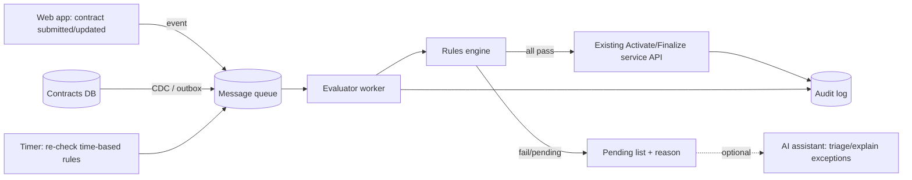

# Live Contract Activation/Finalization (Replacing the Daily Batch)

## Context
Insurance web app (extended warranty, replacement warranty, etc.). Contracts are activated/finalized either manually (users clicking through steps) or by a daily batch job when certain conditions are met. Goal: evaluate contracts continuously (24/7) instead of once a day.

## Should it be an "AI agent"?
For the finalization decision itself, no. Activating/finalizing insurance contracts is a regulated, rule-based decision that must be:
- **Deterministic**: same input, same result
- **Auditable**: show exactly which rule passed or failed
- **Explainable** to auditors and regulators

Use an **event-driven rules service** that runs continuously. Use AI only as an advisory layer.

## Architecture

### 1. Triggers
- **Events (primary):** publish a message when a contract is created or changes.
  - **Transactional outbox:** write the event row in the same transaction as the contract change; a relay publishes it to the queue.
  - **CDC:** SQL Server Change Tracking or Debezium reads changes directly from the database.
- **Time-based re-checks:** some conditions become true without any data change (e.g. waiting period elapsed, payment cleared after N days). When a contract fails only because of time, schedule a delayed message for when it could pass (Azure Service Bus scheduled messages, Durable Functions timers, Temporal).
- **Safety-net sweep:** a lightweight job every 5-15 minutes catches anything whose event was missed. Replaces the daily batch.

### 2. Rules engine
- Externalize rules so the business can change them without a redeploy: NRules (.NET), Drools, DMN decision tables, or a simple JSON/DB rule table.
- Each evaluation returns pass/fail and a reason for every rule, not just yes/no.
- Store the rule version used for each decision.

### 3. Execution
- **Call the same service/API the UI buttons call.** Never write to the DB directly; that bypasses validations, side effects, and notifications.
- **Idempotency:** finalizing twice must be harmless (contract state checks + optimistic concurrency via rowversion/ETag).
- **Concurrency:** handle a user clicking "Finalize" while the worker processes the same contract (lock or version check).

### 4. Operations
- **Audit log:** who/what finalized, when, which rules and rule version applied.
- **Kill switch / feature flag** to pause automation immediately.
- **Dead-letter queue** plus alerting for failures.
- **Dashboard:** auto-finalized count, pending count, top failing rules.

## Rollout plan
1. **Shadow mode:** run the live evaluator alongside the batch, logging only what it *would* do. Compare against batch results.
2. **Partial enablement:** turn on for one product type or a small percentage of contracts.
3. **Full cutover:** batch becomes the fallback sweep only, then retire it.

## Where AI adds value (advisory only)
- **Exception triage:** explain in plain language why a contract is stuck ("missing proof of purchase, dealer not verified") and suggest next actions to staff.
- **Document checks:** extract data from uploaded invoices/receipts to feed the rules; human confirms when model confidence is low.
- **Ops assistant:** answer "why wasn't contract X finalized?" by querying the audit log.

The rules engine and service always make the final decision.

## Open questions
1. Stack: .NET, Java, or Node? Which database? Cloud (Azure/AWS) or on-prem?
2. Do rules depend only on contract data, or also on external systems (payments, dealers, third-party APIs)?
3. Contract volume per day, and required latency (seconds vs minutes)?
4. Is the finalize logic exposed as an API today, or buried in batch/UI code?
