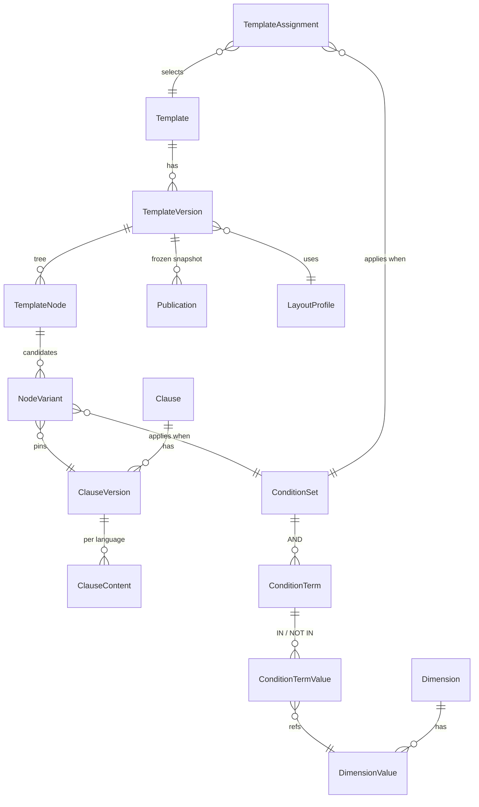

# Plan v2.1: PDF knowledge base + AI form drafting (demo)

Break the latest EW contract PDFs into a searchable knowledge base (page-1 fillable layout + policy clauses in English and French, with formatting, tags and duplicates grouped), produce an analysis report, then build a small app where a user describes a new program and a local AI assembles a draft form (page 1 + policy pages) from existing clauses. The user edits the draft and publishes it as a PDF.

## Decisions

- Demo project, independent of the current app. No DPACCP data; tags come from file names, PDF text and AI.
- Corpus: `C:\repos\tfs\DP_Unifi_Resources\Dev\_ACCP\Forms\Src\EW` (read-only), latest revision per form number + variant + language.
- Stack: Python pipeline (PyMuPDF, pdfplumber) + FastAPI + React (TipTap editor).
- Knowledge base store: SQL Server 2025, schema `kb`, native `json` and `VECTOR` types.
- AI: Ollama only, local (RTX PRO 1000 Blackwell laptop GPU, ~8 GB). Nothing leaves the machine.
  - Text model: `qwen3:8b` or `qwen2.5:7b-instruct`.
  - Search model: `bge-m3` (multilingual, 1024 dims) for meaning-based search and EN/FR pairing.
  - Ollama exposes an OpenAI-compatible API, so Azure OpenAI can be swapped in later by configuration.
- Page 1: start from the closest existing fillable page; AI proposes label/field changes; regenerate with PyMuPDF widgets.
- Policy pages: block JSON -> HTML/CSS -> PDF via Playwright. Same HTML/CSS drives the editor preview (Paged.js).
- Look: same look within a product family (one style profile per product); other products may differ.
- Pages can grow; no page-count limit.
- Fonts: free substitutes (e.g. Roboto Condensed / Arial Narrow-like), mapped from the fonts found in the PDFs.
- Source is PDF only (made in Acrobat); everything is reverse-engineered from the PDFs.
- AI never adds a clause silently: every output points to a source clause or is marked as AI-written.
- Out of scope: scanned PDFs (OCR), folders other than EW, approval workflow, integration with the existing print API.

## Text format and layout (from E7024 policy pages)

| Element in the PDF | How it is stored |
|---|---|
| Centred bold capital titles across full width (TERRITORIAL LIMITS, DEFINITIONS, SCHEDULE OF SERVICES, TERMS AND CONDITIONS) | `sectionTitle` block |
| Bold intro lines across full width ("Replacement parts may be new…", "This Contract is between You and Us…") | `lead` block |
| 2 or 3 justified columns, changing count partway down a page | Layout region with `columns: 1/2/3`; blocks flow inside it across columns and pages |
| Defined terms always bold (Claim, Contract, Page 1, You, Your Vehicle, Mechanical Breakdown) | `definedTerm` mark pointing to its Definitions entry; bold applied automatically |
| Definition entries (**Term** – text…) | `definition` block (term + body) |
| "1. **Hybrid Electric:** text…" | `numberedItem` block with bold lead-in heading; numbers generated automatically |
| Nested lists a) b), I) II), bullets | `list` block with style decimal / lower-alpha) / upper-roman) / bullet |
| Small tables inside a column (Odometer / Minimum Plan Term; Total Repair Cost / Max Days) | `table` block, never split across columns |
| Underlined text ("valid receipts required", "PRIOR") | `underline` mark |
| References ("Section C on Page 1", "clauses 1–14", "Section 6") | `xref` mark to the target clause (or page-1 section); renumbered on publish |

## Steps

### Phase 1: Inventory (`src/pipeline/inventory.py`)

1. Scan the EW folder and parse each file name: type prefix (Contract, Aftersale, AIM, HEA, …), form number, variant suffix, month + year, language (E/F).
   - Handle odd names: `Contrac_`, `F-.pdf`, two-digit years (`JAN19`), upper-case `.PDF`, stray files (`delete.pdf`).
2. Keep only the latest revision per form number + variant + language.
3. For each kept PDF record: page count, page size, fillable fields (count, pages), real text vs scanned, fonts used. Output `output/inventory.csv`.

### Phase 2: Extraction (depends on 1)

4. Page 1: save a layout JSON with each field's name, type, position, options, font size; fixed labels and positions; logos/images with a fingerprint.
5. Policy pages:
   1. Detect full-width bands and column count per band (cluster text start positions).
   2. Read text styles: bold (font flags/name), underline (drawn lines under text), centred (position in region), size.
   3. Rebuild structure: list markers and indent -> nesting; bold phrase + colon -> lead-in heading; tables per column; join paragraphs split by column/page breaks and hyphenation.
   4. Remove repeated headers, footers and page numbers.
   5. Read the defined-term list from DEFINITIONS (EN and FR, paired) and tag bold occurrences as `definedTerm`.
   6. Detect cross-references ("Section X", "clauses N–M", "on Page 1") and link them to targets.
   7. Output content blocks in the format above.

### Phase 2b: Style profile per product (depends on 2)

6. Measure across forms of a product: font sizes/weights per block type, line spacing, margins, column gaps, alignment, page size. Store as `StyleProfile`.
7. Map each PDF font to a free substitute.

### Phase 3: Clauses and duplicates (depends on 2)

8. Split into clauses: heading + content until the next heading at the same or higher level.
9. Exact duplicates: normalise text (spacing, hyphenation, quotes, ligatures) and hash.
10. Near duplicates: word-shingle overlap + embedding similarity; group into one standard clause with variants; store the differences.
11. Pair each English clause with its French version (paired E/F files, clause order, `bge-m3` similarity).

### Phase 4: Tagging (parallel with 3 once 2 is done)

12. Suffix glossary: list every variant suffix (FG, LM, HA, RR, BW, 3D, VC, QG, TT, RV, …) with example forms, for the user to confirm meanings.
13. Pattern tags: OEM names, vehicle types, provinces, coverage names, term/km limits.
14. AI tags: program/product from page 1; clause category (definitions, coverage, exclusions, claims, cancellation, transfer, deductible, limits, provincial notices, privacy, dispute resolution). Results cached by text hash.

### Phase 5: Knowledge base (depends on 3 and 4; `src/db/kb_*.sql`)

15. Schema `kb` in SQL Server 2025:
    - `Document`, `Page`, `FormField`, `PageLayout` (JSON), `Asset`
    - `Clause`, `ClauseVariant` (EN/FR text, block JSON, hash, `VECTOR(1024)`)
    - `DocumentClause` (form, order, section)
    - `Tag`, `DocumentTag`, `ClauseTag`, `SuffixGlossary`
    - `StyleProfile` (product family, style JSON), `DefinedTerm` (EN/FR, owning clause), `CrossRef` (source -> target)
    - Exact `VECTOR_DISTANCE` search is fast enough at this size; no vector index needed.

### Phase 6: Analysis report (depends on 5; `output/report.html` + notebook)

16. Corpus statistics; clause reuse (clauses appearing in N forms); clauses unique to one form; clauses with many variants and what differs; page-1 field catalogue (common fields, naming inconsistencies); suffix glossary; EN/FR pairing gaps; style profiles per product.

### Phase 7: Drafting app (depends on 5; `src/api` FastAPI, `src/web` React + TipTap)

17. Search clauses and forms by keyword + meaning, filtered by tag.
18. Draft from a brief:
    1. User enters product, program name, OEM(s), vehicle type, provinces, coverage, term/km, optional base form.
    2. App finds the closest existing forms.
    3. AI returns a JSON outline referring to existing clause IDs; changed/new text is marked with a diff against the source.
    4. French uses the paired French clause; any AI translation is marked.
    5. AI works on block JSON only; defined terms re-marked automatically after edits; numbers and cross-references recalculated on publish.
19. Page 1: copy the closest page-1 layout; AI suggests label/field edits; user approves each.
20. Editor: custom TipTap nodes for defined terms (autocomplete from the draft's Definitions), cross-references, numbered items with lead-in headings, list styles, tables, column regions. Preview with Paged.js using the product's HTML/CSS template.
21. Publish: Playwright prints the same HTML/CSS (CSS columns, `break-inside: avoid` for tables, justified text, hyphenation); PyMuPDF rebuilds page 1 (labels, logos, fillable fields); merge; store the PDF with a hash.

## Files

- Source PDFs (read-only): `C:\repos\tfs\DP_Unifi_Resources\Dev\_ACCP\Forms\Src\EW` (sample `Contract_E7024JAN2026E.pdf` / `F.pdf`)
- New: `src/pipeline/` (inventory, extract, style, segment, dedupe, tag, load), `src/db/`, `src/api/`, `src/web/`, `output/`
- `.env`: PDF folder path, SQL connection (Windows authentication, no stored password), Ollama URL.

## Verification

1. Inventory row count equals EW file count; unparsed names listed; latest-revision pick spot-checked on 7024, 7470, 7091.
2. Extraction on 5 sample forms (incl. `E7024JAN2026E/F`): text coverage ≥ 98%; page-1 fields match Acrobat.
3. Rebuild test: render extracted blocks with the product style profile and compare with original pages — text match ≥ 98%, same column count and region boundaries per page, all bold defined terms kept, side-by-side images for visual review (line breaks may differ).
4. Clause split for E7024 vs a manual list: ≥ 90% matching boundaries.
5. Defined terms: every bold term in E7024 that appears in DEFINITIONS is tagged.
6. Cross-references: every "Section N" / "clauses N–M" in E7024 links to an existing clause; numbers update after removing a clause.
7. Near-duplicate grouping: review 20 clusters by hand.
8. End-to-end: draft a new program from E7024, edit one clause, publish; PDF opens, page-1 fields fillable, EN and FR produced.

## Further considerations

1. Scanned PDFs: skip for the demo (recommended); add Tesseract OCR later if needed.
2. Report as a Jupyter notebook plus exported HTML.

---

# Appendix: v1 design — `fc` publishing model (for later)

Kept for when the demo moves toward production publishing. New schema `fc` on SQL Server 2025. Each clause is written once, versioned and translated, then placed into templates. A rule decides which version of a clause appears for a given contract. Templates are frozen into a snapshot when they are published, and the new renderer prints from that snapshot.

## Problems in the current model this design fixes

Current tables: `cfFormTemplate`, `cfFormTemplateSection`, `cfFormTemplateSectionDetl`, `cfFormTemplateLogo`.

- **No history:** each detail row is overwritten in place, so there are no versions and no way to roll back.
- **No reuse:** the same clause text is copied into each Program/OEM row.
- **Comma-separated lists:** `ProvStates`, `OEMs` and `CoverageCalcLogic` hold several values in one text field.
- **Unclear "applies to all":** an empty `DealerGroup` and `'%'` are both used to mean all dealer groups.
- **Fixed variation fields:** the fields that make text vary are hard-coded columns. Adding Vehicle Type would mean changing the schema.
- **No review step:** there is no draft, review, approve and publish workflow.
- **Text stored as plain strings:** the text is URL-encoded, so formatting such as bold, lists and tables is lost. You can't compare one version with another.
- **Unknown print logic:** the external Print Certificate API does the printing, and its logic is not visible.

## How the new model fits together

## Steps

### Phase A: Core model (written as DDL in `src/db/`)

1. **Dimensions:** the things text varies by become data, not columns.
   - `Dimension` has a Code, names in English and French, a source and an active flag.
   - `DimensionValue` holds the allowed values for each dimension.
   - The values are copied regularly from the existing lookup tables: `cfProduct`, `cfProgram`, `zcOEM`, `zcProvState`, `zcDealerGroup`, `zcContractType`, `cfCoverageType`, `cfOptionCovg` and `cfSurcharge`.
   - Vehicle Type is added as one more dimension, with no schema change.
2. **Conditions** (*depends on 1*): these replace the comma-separated lists and the empty / `'%'` confusion.
   - `ConditionSet` groups `ConditionTerm` rows. A term names one dimension, an operator (`IN` or `NOT_IN`) and its values in `ConditionTermValue`.
   - Within a set, terms are combined with AND, and the values inside one term with OR.
   - An empty set matches every contract, which gives a clear default.
3. **Clause library:**
   - A `Clause` is the logical clause and carries a code, a category and tags.
   - Each change creates a new `ClauseVersion` with a status: Draft, InReview, Approved or Retired. A version can't be changed once approved.
   - `ClauseContent` holds the text for each language (E or F). The text is a native `json` column, with a computed plain-text copy for search and a hash to find duplicates.
4. **Templates** (*depends on 2 and 3*):
   - A `Template` is one form, such as FormId 7024 under a product and form type.
   - A `TemplateVersion` is one revision of it, such as JAN2026. It has effective and expiry dates, a status and a page layout.
   - `TemplateNode` defines the outline of sections and clause slots, with order, titles and a "required" flag.
   - `NodeVariant` lists the possible clauses for each slot. Each one points to a specific approved clause version and has a priority.
5. **Template selection** (*depends on 2*): `TemplateAssignment` uses the same condition mechanism to pick which form a contract gets.
6. **Page layout:** `LayoutProfile` holds page size, margins, number of columns, fonts and header/footer settings, kept separate from the text.
7. **Publishing and audit:**
   - `Publication` stores the fully assembled, frozen snapshot for each template version and language, with a hash. It can't be changed after it is created.
   - `ReviewRequest` enforces that the approver is a different person from the author.
   - `AuditEvent` logs changes, and SQL Server temporal tables keep the full history of draft tables.

### Phase B: Text format (parallel with A)

8. Define the allowed block types as a JSON Schema in `src/schema/content.schema.json`:
   - `heading` (level 1–4)
   - `paragraph`, where text runs can be bold, italic or underlined
   - `list`: numbered, bulleted or lettered, with nesting
   - `table`
   - `pageBreak`, `columnBreak` and `keepTogether`

   Pick a block structure that the TipTap/ProseMirror editor can convert to and from without loss.

### Phase C: How a contract's text is assembled (depends on A)

9. Write the steps in `src/docs/resolution.md`:
   1. Start from the contract's dimension values.
   2. Pick the template using `TemplateAssignment`.
   3. Pick the `TemplateVersion` that was in effect on the contract's sale date.
   4. Walk the outline. For each slot, choose the matching variant with the highest priority. If two tie, choose the one with more conditions.
   5. If no variant matches, leave the slot out, or report an error if it is required.
   6. Output the blocks, convert them to HTML, then to PDF.
10. Checks before a version can be published:
    - It is blocked if two variants with the same priority could both match the same contract.
    - It warns, with a coverage grid, if a required slot has no clause for some combination of values.
    - It is blocked if the French or English text is missing.
11. Contracts store the `PublicationId` they were printed from, so a reprint gives exactly the same text.

### Phase D: Test the design on a real form (depends on A–C)

12. Model the policy pages of `E7024JAN2026E` and `E7024JAN2026F` by hand into sample data in `src/db/seed_sample.sql`. Then confirm that the assembly steps rebuild them and that the conditions cover the real differences.

### Phase E (next, after design approval): Data analysis

13. Extract the text from the PDF policy pages and export the old detail rows.
14. Match identical or near-identical text into shared clauses.
15. Turn the old rows into conditions, and report what can't be mapped.

## Relevant files

- `C:\repos\tfs\DP_Unifi_NEW\Dev\ACCP\Libraries\DPUnifiDB\dbo\Tables\cfFormTemplate.sql`, `cfFormTemplateSection.sql`, `cfFormTemplateSectionDetl.sql`, `cfFormTemplateLogo.sql`: the current model, used as the source to migrate from.
- `C:\repos\tfs\DP_Unifi_NEW\Dev\ACCP\Libraries\DP.BL\Src\DPmFormTemplate.vb`: current filtering and URL-decoding of text, which needs matching behaviour.
- `C:\repos\tfs\DP_Unifi_NEW\Dev\ACCP\Libraries\DP.BL\Src\DPmFormPrint.vb`: how printing is done today through the external API. This is where the new renderer will connect later.
- PDF sources: `C:\repos\tfs\DP_Unifi_Resources\Dev\_ACCP\Forms\Src` (sample: `EW\Contract_E7024JAN2026E.pdf`).
- New files: `src/db/*.sql`, `src/schema/content.schema.json`, `src/docs/resolution.md`.

## Verification

1. The DDL deploys cleanly to an empty SQL Server 2025 database, and the sample data loads.
2. The JSON Schema accepts the E7024 sample content and rejects invalid blocks.
3. Assembling E7024 for 3–4 different combinations of dimension values gives the expected list of clauses.
4. The publish checks catch a deliberately overlapping variant and a missing French text.

## Decisions

- Database: SQL Server 2025, relational tables plus `json` columns, in a separate `fc` schema.
- Dimensions are data. Lookup values are copied from DPACCP, not linked by foreign keys across databases.
- Approved clause versions can't be changed. Templates point to specific clause versions, and a "where used" view shows which templates need updating when a clause changes.
- There are no merge fields, because the text is static.
- The fillable page 1, logos and the editor UI are not part of this phase. Logos can later become a block type.

## Points to confirm

1. **Effective date for picking a version:** recommend the contract's sale date rather than the print date, so reprints stay the same as what was issued.
2. **Clause updates inside a template:** recommend pinning each slot to a specific clause version and offering a one-click "update to latest" before publishing. Templates would not move to the newest version automatically.
3. **PDF renderer:** recommend Playwright HTML→PDF, so the PDF looks the same as the editor preview and two-column layout is handled by CSS. QuestPDF would need a paid licence at company scale.
